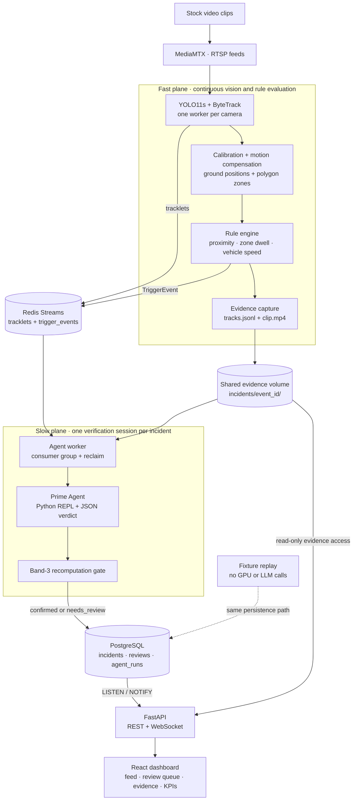
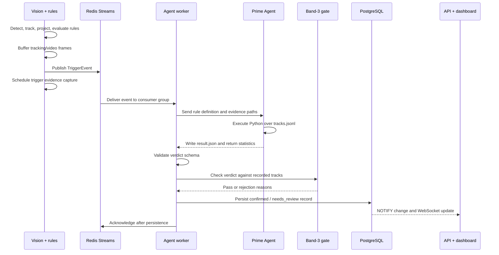

# ForgeGuard AI

**Industrial safety monitoring with computer vision, agent verification, and an auditable evidence trail.**

ForgeGuard AI watches camera feeds for unsafe interactions between people and heavy machinery.
It detects and tracks objects, measures movement on the ground plane, applies explicit safety
rules, and sends triggered events to an agent that verifies the evidence by running Python.
A separate recomputation gate checks supported claims before the incident reaches the dashboard.

**Project status:** portfolio prototype with milestones M0–M7 documented. Includes a recorded
showcase, a Docker replay demo, a GPU video pipeline, evaluation reports, and reference cloud
infrastructure. See the [roadmap](docs/12-roadmap.md) for completed work and remaining gaps.

## Demo


*Detection and tracking → rule trigger → Prime Agent verification → Band-3 check → stored
incident. The dashboard replays real pipeline output and recorded agent sessions. The recording
does not run a detector or language model in the browser.*

The three camera videos remain included under [`ui/public/showcase/`](ui/public/showcase/):
[dock](ui/public/showcase/dock_north_01/video.mp4),
[warehouse aisle](ui/public/showcase/warehouse_aisle_01/video.mp4), and
[excavator yard](ui/public/showcase/yard_excavator_01/video.mp4).
[Run the recorded dashboard](#recorded-showcase) or [start the replay stack](#quickstart).

## Contents

- [Overview](#overview)
- [Features](#features)
- [Technology stack](#technology-stack)
- [Quickstart](#quickstart)
- [Architecture](#architecture)
- [Incident lifecycle and verification](#incident-lifecycle-and-verification)
- [Safety rules and calibration](#safety-rules-and-calibration)
- [Configuration](#configuration)
- [API reference](#api-reference)
- [Repository structure](#repository-structure)
- [Development and testing](#development-and-testing)
- [Measured results](#measured-results)
- [Deployment and operations](#deployment-and-operations)
- [Limitations and future work](#limitations-and-future-work)
- [Documentation](#documentation)
- [Glossary](#glossary)
- [Third-party licenses](#third-party-licenses)

## Overview

Warehouses and construction sites put workers near moving vehicles, restricted aisles, and
active machinery. ForgeGuard AI explores how to turn camera footage into useful, reviewable
incident records for three situations:

- **Proximity:** a vehicle remains too close to a pedestrian.
- **Zone intrusion:** a person stays inside a restricted area beyond its dwell limit.
- **Speed:** a vehicle exceeds a configured limit within a monitored zone.

The design separates continuous monitoring from slower verification. Computer vision runs on
the frames, while geometry and written rules decide when an event warrants investigation.
Only then does the language model run. It receives structured tracking evidence, executes
calculations in a Python REPL, and returns a schema-validated verdict.

The demonstration uses stock footage looped as simulated RTSP cameras. Detection, tracking,
geometry, rules, agent integration, persistence, and the dashboard are implemented. The clips
are not footage from an actively monitored site, and the project is a prototype.

## Features

| Area | Implemented capabilities |
| --- | --- |
| Video ingestion | MediaMTX serves looping clips as RTSP streams; one vision worker per demo camera |
| Detection and tracking | YOLO11s through Ultralytics, ByteTrack tracking, and Kalman motion estimation |
| Spatial measurements | Pixel-to-ground homography, three calibration methods, camera-motion compensation, and polygon zones |
| Rule engine | Proximity, continuous zone dwell, vehicle speed limits, and cooldowns per rule |
| Evidence capture | Tracking windows and video clips around triggers, with agent transcripts for completed runs |
| Agent verification | Prime Agent runs Python over evidence files through a headless JSON-lines RPC session |
| Verification gate | Independent distance/closing-velocity recomputation and zone-dwell verdict checks |
| Incident handling | `confirmed` and `needs_review` records, evidence links, rejection reasons, and human review submissions |
| Dashboard | Incident feed, review queue, KPI counts, recorded camera overlays, floor plan, and shift report |
| Evaluation | Detection benchmarks, MOT17 tracking evaluation, 30 labeled incident fixtures, and agent contract tests |
| Infrastructure | Docker Compose stacks and Terraform reference environments for AWS, GCP, and Azure |

### Why use an agent after the rules?

Rules provide fast, explicit triggers, but a trigger alone does not explain whether the event
was a violation, a near miss, ordinary work, or a false positive. The agent adds a classification
and narrative without making a language-model call for every frame.

Prime Agent supplies a persistent Python REPL: the model can load `tracks.jsonl` and compute
distances and movement instead of estimating numbers from prose. This project uses one
verification session per incident. Recursive sub-agent orchestration and Prime Agent's Continual
Harness were part of the broader design and are not implemented here.

## Technology stack

| Layer | Technologies |
| --- | --- |
| Vision and video | Python, Ultralytics YOLO11s, ByteTrack, OpenCV, PyAV, PyTorch; optional TensorRT FP16 |
| Geometry and contracts | NumPy, Shapely, Pydantic v2, YAML configuration |
| Messaging | Redis Streams and consumer groups |
| Agent runtime | Prime Agent v0.9.3 integration, Python REPL, JSON-lines RPC, external process timeout |
| Backend and storage | FastAPI, Uvicorn, asyncpg, PostgreSQL 16, REST, WebSocket, LISTEN/NOTIFY |
| Frontend | React 18, TypeScript, Vite, Tailwind CSS |
| Quality checks | pytest, Ruff, mypy, Vitest, TypeScript build checks, GitHub Actions |
| Packaging and infrastructure | uv, npm, Docker Compose, MediaMTX, Terraform |

## Quickstart

Run commands from the repository root unless a step explicitly changes directories.

### Choose a mode

| Mode | Requirements | What runs |
| --- | --- | --- |
| Recorded showcase | Node.js 20+ and npm | Dashboard with committed videos, recorded tracks, incidents, and agent sessions |
| Docker replay | Docker with Compose v2 | PostgreSQL, API, dashboard, and replay of 30 labeled fixtures; no GPU or model credentials |
| Full video pipeline | Docker with NVIDIA GPU access, source clips, weights, and configured Prime Agent | RTSP ingestion, vision, Redis, agent verification, PostgreSQL, API, and dashboard |

### Docker replay — recommended first run

```sh
docker compose -f docker/docker-compose.replay.yml up --build
```

Open the [dashboard](http://localhost:5173), [interactive API docs](http://localhost:8000/docs),
or [health endpoint](http://localhost:8000/healthz). Fixture incidents arrive every 15 seconds.
Open an incident to inspect its measurements, narrative, and evidence, or filter the feed to
`needs_review` to inspect rejected verification results.

Replay exercises the database, API, WebSocket updates, and review workflow using fixtures. It
does not run detection or make model calls; some fixture incidents have no video clip.

Stop the stack with:

```sh
docker compose -f docker/docker-compose.replay.yml down
```

With GNU Make, `make replay-up` and `make replay-down` are equivalent shortcuts. Named volumes
retain data between runs. Replay and full mode both use ports 5173 and 8000; stop one before
starting the other.

### Recorded showcase

This mode plays the included videos, frame overlays, and agent transcripts without a backend.
Install the frontend dependencies first:

```sh
cd ui
npm ci
```

In **PowerShell**:

```powershell
$env:VITE_STATIC_DEMO = '1'
npm run dev
```

In **Bash / zsh**:

```sh
VITE_STATIC_DEMO=1 npm run dev
```

Open [localhost:5173](http://localhost:5173). The **Cameras** view shows boxes, zones, distances,
and the floor plan. At recorded rule triggers, playback shows the agent session and gate result.
The aisle incident includes an earlier run in which the gate rejected the agent's answer.
Reviews are disabled in static mode because there is no database.

Clear `VITE_STATIC_DEMO` before returning to backend-connected development. In PowerShell,
use `Remove-Item Env:VITE_STATIC_DEMO`; in Bash / zsh, use `unset VITE_STATIC_DEMO`.

### Full video pipeline

Prepare these dependencies before building:

1. **GPU access:** an NVIDIA GPU and the NVIDIA Container Toolkit, or equivalent Docker Desktop
   GPU support. Python is provided inside the containers.
2. **Source videos:** download the clips and create the expected `*_1080p.mp4` transcodes using
   [the clip setup guide](assets/clips/README.md). Sources and hashes are in
   [the Pexels manifest](data/manifests/pexels-demo-clips.yaml).
3. **Detector weights:** place `yolo11s.pt` in `data/models/` using
   [the weights manifest](data/manifests/yolo11-weights.yaml) and verify its SHA-256 hash.
   The container mounts this directory read-only and cannot download missing weights.
4. **Prime Agent:** prepare the project's tested v0.9.3 package and configure a model provider
   in its harness directory. The container expects a vendored tarball in `docker/vendor/`;
   follow [the packaging guide](docker/vendor/README.md). The integration does not assume a
   public npm package is available.
5. **Harness mount:** set `PRIME_HARNESS_DIR` if the host configuration is not in `~/.prime`.

```sh
docker compose -f docker/docker-compose.yml up --build
```

Open [localhost:5173](http://localhost:5173). Stop with
`docker compose -f docker/docker-compose.yml down`. Make shortcuts: `make up` and `make down`.

The camera workers share one detector image. The dock runs metric rules, the aisle runs zone
rules, and the yard runs detection/tracking only. The dashboard's camera overlay remains a
recorded showcase; live track-to-browser streaming is unfinished.

## Architecture

### System components



The boundary between the planes is a validated `TriggerEvent` plus its evidence window. The
agent operates on structured tracking data and rule definitions rather than raw video.
Video remains available as evidence for a human reviewer.

| Component | Responsibility | Implementation |
| --- | --- | --- |
| Vision worker | Decode frames, detect objects, keep track IDs, publish tracklets | [`pipeline.py`](pipelines/vision/pipeline.py) |
| Geometry | Ground projection, calibration, zones, camera motion | [`pipelines/geometry/`](pipelines/geometry/) |
| Rule engine | Evaluate rules and cooldowns | [`rules.py`](pipelines/vision/rules.py) |
| Evidence capture | Save tracking and video windows | [`evidence.py`](pipelines/vision/evidence.py) |
| Broker | Stream retention, consumer groups, stale-entry reclaim | [`pipelines/broker/`](pipelines/broker/) |
| Agent worker | Prepare prompts, invoke the agent, gate output, persist results | [`worker.py`](agent/worker.py) |
| Prime adapter | Start the process, handle RPC, enforce timeout/termination | [`prime_adapter.py`](agent/prime_adapter.py) |
| Band-3 gate | Recompute supported measurements, reject disagreements | [`band3.py`](agent/band3.py) |
| API and database | Incidents, reviews, evidence, updates, reports | [`api/`](api/) |
| Dashboard | Incidents, review queue, KPIs, recorded evidence | [`ui/`](ui/) |

### Incident sequence



More C4 context/container views and sequences are in
[the architecture diagram guide](docs/13-architecture-diagrams.md).

## Incident lifecycle and verification

### Data contracts

[Pydantic models](pipelines/schemas/models.py) define process boundaries. Unexpected fields
are rejected; exported JSON Schemas live in [`schemas/`](schemas/).

| Contract | Contains |
| --- | --- |
| `TrackletFrame` | Camera/time/sequence, calibration quality, tracks, ground positions, velocities, zones |
| `TriggerEvent` | Event ID, rule, camera, involved tracks, metrics, evidence references, cooldown key |
| `KinematicsVerdict` | Verified distance, closing velocity, time to collision where available, classification |
| `IncidentRecord` | State, classification, metrics, rejection reason, narrative, citations, evidence, run statistics |

Classifications are `violation`, `near_miss`, `normal_ops`, and `false_positive`.
**`confirmed` means verification was accepted; it does not mean a safety violation occurred.**
A confirmed event can be ordinary work or a verified false positive.

### What the Band-3 gate checks

- **Proximity:** recompute minimum distance and closing velocity from the involved tracks.
  Distance tolerance is **0.15 m or 5%**, whichever is larger; closing-velocity tolerance is
  **0.2 m/s or 5%**, whichever is larger.
- **Zone intrusion:** recompute continuous in-zone dwell at the trigger frame. A `violation`
  must be supported by the dwell threshold; a `false_positive` must not contradict it.
  The comparison allows **0.2 s** tolerance. `normal_ops` and `near_miss` remain judgment calls.
- **Speed incidents:** output is schema-validated, but independent speed-rule recomputation
  is not implemented in the gate.

The gate uses the same saved tracks. It does not re-detect objects, independently validate
the camera calibration, or prove every semantic classification correct.

### Failure handling

Timeouts, missing/malformed verdicts, missing tracking evidence, and gate disagreements produce
`needs_review` records when the worker can handle the failure. Available evidence and rejection
reasons are retained. Unexpected processing or database failures leave the entry unacknowledged
for reclaim/retry; persistence uses an idempotent write.

Each incident gets a fresh Prime Agent process. The adapter applies an external **210 s**
timeout and terminates the process when exceeded. See
[the headless-agent spike](docs/spikes/spike-01-prime-agent-headless.md).

## Safety rules and calibration

Rules live in [`config/rules.yaml`](config/rules.yaml). Included thresholds are project-specific
demo policies, not claims of regulatory compliance.

| Rule | Trigger condition | Cooldown |
| --- | --- | --- |
| `proximity_forklift_pedestrian` | Vehicle/pedestrian separation within 3 m for 2 s in the dock zone | 120 s |
| `exclusion_mobile_plant_dock` | Pedestrian within the 5 m mobile-plant warning radius for 2 s | 120 s |
| `intrusion_forklift_aisle` | Person in the forklift-only cross-aisle for 3 s | 120 s |
| `intrusion_excavator_swing` | Person in the swing zone for 3 s, when usable calibration exists | 120 s |
| `speed_limit_dock` | Vehicle exceeds 2.2 m/s in the dock zone | 60 s |

A separate dining-room camera and rule are calibration tooling fixtures.

### Calibration behavior

Calibration maps the bottom-center of a detection box from pixels onto the ground plane in
meters. Methods include measured points, vanishing-point geometry, and a level-camera method.
A reference image enables per-frame compensation for camera movement.

The quality gate is **RMS reprojection error ≤ 2.0 px**:

| Calibration state | Enabled behavior |
| --- | --- |
| Valid calibration | Ground positions, zones, distance rules, speed rules |
| Calibration exists but fails the gate | Zone membership/dwell; metric proximity and speed disabled |
| No calibration | Detection/tracking only; no spatial rules |

| Demo camera | Behavior and assumptions |
| --- | --- |
| `dock_north_01` | Motion-compensated metric calibration; scale from wheel track and human height, roughly ±8% distance uncertainty |
| `warehouse_aisle_01` | Deliberately unverified calibration; zone-only mode without trusted distances/speeds |
| `yard_excavator_01` | Uncalibrated; tracking only, with limited excavator recognition |

Use `make calib` or `uv run python -m pipelines.geometry.calibrate`. See
[`config/calibration/`](config/calibration/) and [data and models](docs/04-data-and-models.md)
for recorded assumptions and methods.

## Configuration

| File/directory | Controls |
| --- | --- |
| [`config/cameras.yaml`](config/cameras.yaml) | Camera IDs, URLs, dimensions, confidence gates |
| [`config/zones.yaml`](config/zones.yaml) | Ground-plane polygon zones |
| [`config/rules.yaml`](config/rules.yaml) | Kinds, thresholds, zones, severity, cooldowns, policy citations |
| [`config/calibration/`](config/calibration/) | Homographies, quality, assumptions, reference images |
| [`config/shifts.yaml`](config/shifts.yaml) | Shift definitions |
| [`docker/mediamtx.yml`](docker/mediamtx.yml) | Clip-to-RTSP mapping |
| [`agent/prompts/`](agent/prompts/) | Verification instructions and classification policy |

### Environment and runtime settings

| Setting | Purpose |
| --- | --- |
| `DATABASE_URL` | API PostgreSQL connection; the worker gets its DSN through `--postgres-dsn` in Compose |
| `REDIS_URL` | Pipeline broker connection; the worker also accepts `--redis-url` |
| `YOLO_WEIGHTS` | Weight path; vision container default `/models/yolo11s.pt` |
| `EVIDENCE_ROOT` | Evidence directory written by the vision pipeline |
| `WORKSPACE_ROOT` | API evidence root; worker paths use `--workspace-root` and `--evidence-root` |
| `PRIME_HARNESS_DIR` | Host folder mounted at agent `/home/node/.prime`; Compose defaults to `~/.prime` |
| `BIND_ADDR` | Host interface for published ports; default `127.0.0.1` |
| `TEST_DATABASE_URL` | Enable PostgreSQL integration tests against a reachable test database |
| `VITE_STATIC_DEMO` | Set to `1` at frontend start/build to use recordings instead of the backend |
| `VITE_BASE` | Static-hosting base path; default `/` |

Model-provider credentials belong in Prime Agent's harness configuration. Do not commit that
directory or provider keys. Cloud credentials are not needed for local demos.

## API reference

[Interactive OpenAPI docs](http://localhost:8000/docs) are available while the stack is running.

| Method | Endpoint | Purpose |
| --- | --- | --- |
| `GET` | `/healthz` | Application health |
| `GET` | `/api/v1/cameras` | Configured cameras |
| `GET` | `/api/v1/cameras/{camera_id}/health` | Placeholder response; live watchdog not wired |
| `GET` | `/api/v1/zones` | Zone configuration |
| `GET` | `/api/v1/rules` | Rule configuration |
| `GET` | `/api/v1/incidents` | Filter/paginate by time, severity, camera, state |
| `GET` | `/api/v1/incidents/{event_id}` | Full incident record |
| `POST` | `/api/v1/incidents/{event_id}/review` | Reviewer, decision, optional note |
| `GET` | `/api/v1/incidents/{event_id}/evidence/tracks` | Tracking evidence as JSON |
| `GET` | `/api/v1/incidents/{event_id}/evidence/clip` | Video, if available |
| `GET` | `/api/v1/kpis` | Counts by state/classification over a time window |
| `GET` | `/api/v1/shift-report` | HTML report between `from_ts` and `to_ts` |
| `WS` | `/live/ws` | `incident.created` / `incident.updated`, ping/pong |

Examples: `http://localhost:8000/api/v1/incidents?state=needs_review&limit=10` and
`http://localhost:8000/api/v1/kpis?window=24`.

Incident changes broadcast to connected clients. Per-camera subscriptions and live frame ticker
events are not implemented. [Schemas and API](docs/06-schemas-and-api.md) distinguishes designed
from implemented behavior.

## Repository structure

```text
forgeguard-ai/
├── agent/                  # Worker, adapter, prompts, gate, persistence
├── api/                    # FastAPI, PostgreSQL schema/queries, reports
├── pipelines/
│   ├── vision/             # Detector, tracking, rules, evidence, recorder
│   ├── geometry/           # Calibration, homography, motion, zones
│   ├── ingestion/          # Video/frame sources
│   ├── broker/             # Redis Streams and consumer helpers
│   ├── config/             # Validated configuration loading
│   └── schemas/            # Shared Pydantic contracts
├── ui/                     # React + TypeScript dashboard
│   └── public/showcase/    # Videos, tracks, incidents, transcripts
├── config/                 # Cameras, zones, rules, shifts, calibration
├── evaluation/             # Benchmarks, tracking eval, 30-incident eval
├── tests/                  # Python unit, integration, contract tests
├── schemas/                # Exported JSON Schemas
├── scripts/                # Replay, smoke checks, docs/showcase tools
├── docker/                 # Dockerfiles, Compose, MediaMTX configuration
├── deploy/terraform/       # AWS / GCP / Azure reference environments
├── data/manifests/         # Asset origins, licenses, hashes
├── assets/clips/           # Source clips; downloaded separately
├── docs/                   # Architecture, evaluation, security, ADRs
├── .github/workflows/      # CI, contract, Terraform, Pages workflows
├── Makefile                # Developer shortcuts
├── pyproject.toml          # Python dependencies and tooling
└── PLAN.md                 # Scope, milestones, success criteria
```

## Development and testing

Python **3.11+** and uv are required for local Python development; `.python-version` selects
3.11. Frontend development uses **Node.js 20+** and npm. The tested Prime Agent container
uses **Node.js 22.11** separately.

```sh
uv sync
uv run pytest
uv run ruff check .
uv run mypy
uv run python scripts/check_docs.py
```

`uv sync` includes CUDA-enabled PyTorch and may download several gigabytes. PostgreSQL tests
require `TEST_DATABASE_URL`; they skip when the test database is unavailable. The documented
suite contains **191 Python tests** (164 offline, 27 database-dependent) and **6 frontend tests**.

For the dashboard:

```sh
cd ui
npm ci
npm test
npm run build
```

CI is configured to check Python lint/types/tests, documentation consistency, schema export,
frontend tests/build, and Compose configuration. Separate workflows check the recorded Prime
Agent contract and Terraform environments.

### Useful commands

| Command | Purpose | Additional requirements |
| --- | --- | --- |
| `make schema-export` | Regenerate shared JSON Schemas | Python environment |
| `make calib` | Calibration tooling | Reference footage/images |
| `make eval` | Detector benchmark | GPU, clips, weights |
| `make tracking-eval` | MOTA / IDF1 evaluation | MOT17 data; see manifests |
| `make agent-eval` | 30-incident agent evaluation | Configured Prime Agent; provider usage |
| `make showcase` | Re-record camera and frame output | GPU, source clips, weights |
| `make showcase-agent` | Verify recorded triggers | Prepared showcase evidence, Prime Agent |
| `make report` | Generate benchmark/report artifacts | Available evaluation results |
| `make iac` | Format-check/validate three clouds | Terraform and POSIX-compatible shell |

`make showcase` recreates `build/showcase-evidence`; regeneration commands overwrite generated
showcase artifacts. They are not needed to watch included videos. Some Make targets use POSIX
shell commands; on Windows use WSL/Git Bash where needed or the underlying Python/Docker commands.

## Measured results

These are recorded project measurements, not a fresh benchmark of the current machine.
Detection results use an **NVIDIA RTX A4500 laptop GPU**, 1080p video, and model input size 640
unless the linked report specifies otherwise.

| Measurement | Recorded result | Context/evidence |
| --- | --- | --- |
| Single-stream detection | YOLO11s: **35.0 FPS** on the aisle clip | [Benchmarks](docs/benchmarks.md); cool-GPU FP32 baseline |
| TensorRT FP16 | **34–57%** single-stream gain | Same report; hardware-specific engines |
| Three streams | Minimum **30.2 FPS/stream** with FP16 on an idle-recovered GPU; **9.5–13.2 FPS/stream** across sustained-load configurations | Same report; thermal/power conditions matter |
| Agent validation, first pass | **26/30 = 86.7%** | [M5 eval](docs/eval-m5-agent-slow-path.md); four old 150 s timeouts |
| Classification, first pass | **23/28 = 82.1%** agreement | Same report; two deliberate gate-rejection fixtures excluded |
| Timeout-adjusted results | **30/30** validation; **27/28 = 96.4%** classification | Four failed fixtures passed on retest; secondary adjusted results |
| Agent latency | **68.8 s median** | M5 eval; current external timeout 210 s |
| Tracking baseline | **MOTA 0.16–0.46** on MOT17 | [Benchmarks](docs/benchmarks.md); off-the-shelf crowded-street baseline |
| Agent usage | Roughly **43–56K tokens**, **$0.002 per incident** in the recorded setup | [Cost model](docs/10-cost-model.md); historical, provider/model-dependent |

### What the showcase demonstrates

- **Dock:** the 5 m warning fired at about **4.20 m**. The agent recomputed the distance and
  returned `normal_ops`. It is a warning example, not footage of a genuine close call.
- **Aisle:** a pedestrian stayed in the restricted aisle for **3.0 s**. An earlier agent run
  incorrectly called it a false positive. The added zone-dwell gate caught the contradiction
  and routed it to review; including the actual rule definition corrected the next run.
- **Calibration:** real footage exposed a vanishing-point sign ambiguity and an overly strict
  rotation tolerance; implementation and regression checks were updated.
- **Runtime:** real runs exposed the need for external timeouts and Windows-safe UTF-8 RPC pipes.

Agent fixtures validate the schema/agent/gate path. They do not measure real-site hazard recall.

## Deployment and operations

### Local services

| Service | Stack | Host exposure |
| --- | --- | --- |
| `ui` | Both | `127.0.0.1:5173` |
| `api` | Both | `127.0.0.1:8000` |
| `postgres` | Both | Internal; named data volume |
| `replay` | Replay | Internal; writes fixture records |
| `mediamtx` | Full | `127.0.0.1:8554` RTSP, `127.0.0.1:8889` WebRTC |
| `redis` | Full | Internal |
| `vision-dock`, `vision-aisle`, `vision-yard` | Full | Internal; GPU access |
| `agent` | Full | Internal; shared evidence and mounted harness |

The API creates the database schema at startup. PostgreSQL LISTEN/NOTIFY carries incident
changes to the API, which forwards them over WebSocket. The API mounts evidence read-only.

The local API has **no authentication**, and Compose uses demo database credentials. Ports
bind to loopback by default. Changing `BIND_ADDR` exposes services beyond the local machine;
shared/public hosting needs authentication and operational hardening. Full-stack Redis does
not enable durable persistence: consumer reclaim covers worker failures, not broker data loss.

### Troubleshooting

| Symptom | Check |
| --- | --- |
| Ports 5173/8000 occupied | Stop the other stack or process using them |
| No incidents immediately | Replay inserts every 15 s; inspect `docker compose -f docker/docker-compose.replay.yml logs replay api` |
| Detector cannot load | Check `data/models/yolo11s.pt` and the manifest hash |
| RTSP cannot open | Check 1080p source clips and `docker/mediamtx.yml` paths |
| Agent image build fails | Prepare the v0.9.3 tarball using `docker/vendor/README.md` |
| Agent requests fail/time out | Check mounted harness, provider access, incident rejection reason |
| No spatial triggers on a camera | Check calibration; aisle is zone-only, yard is uncalibrated |

### Static hosting

Build with `VITE_STATIC_DEMO=1` and a suitable `VITE_BASE`, such as `/<repository-name>/` for
a GitHub Pages project. Set the base path in the [Pages workflow](.github/workflows/pages.yaml)
to match the destination repository before deployment. The dashboard's
repository link is configured in [`ui/src/config.ts`](ui/src/config.ts).

Static hosting serves recordings only, without a live API, saved reviews, GPU inference, or
model calls.

### Cloud reference infrastructure

[`deploy/terraform/`](deploy/terraform/) includes AWS, GCP, and Azure examples with
[runbooks](docs/deployment/). These were format-checked and validated, **never applied**.
They do not establish that the GPU/agent system has been deployed on those platforms.
See [ADR-004](docs/adr/ADR-004-documentation-only-cloud-deployment.md).

## Limitations and future work

| Current limitation | Follow-up direction |
| --- | --- |
| Stock clips and a small hand-built incident set | Evaluate representative site footage with measured ground truth |
| COCO lacks dedicated forklift/excavator classes | Integrate/train an industrial detector; evaluate precision/recall |
| Estimated calibration; one uncalibrated camera | Survey geometry and quantify uncertainty per camera |
| Nondeterministic agent answers | Expand regression fixtures and latency/classification evaluation |
| Incomplete semantic checks and no speed recomputation gate | Extend independent verification by rule kind |
| Dashboard incidents arrive after agent verification | Add a low-latency alert consumer on `trigger_events` |
| Recorded camera overlay | Implement live track streaming and frame ticker events |
| PPE fields exist but helmet/vest detection is absent | Add dedicated models and evaluation |
| Watchdog and additional agent roles unfinished | Implement and evaluate watchdog, parameter review, compliance, shift synthesis |
| Manual agent packaging and source-asset setup | Publish reproducible runtime artifacts and improve setup |
| Local-demo credentials/authentication | Add identity, access control, secrets management, operational controls |
| Frontend tests cover geometry/frame lookup | Add component/end-to-end coverage and adversarial agent tests |
| One laptop GPU for all performance results | Benchmark sustained load on deployment hardware |

See the [risk register](docs/11-risks.md), [security guide](docs/08-security.md), and
[roadmap](docs/12-roadmap.md) for detailed scope and tradeoffs.

## Documentation

| Document | Covers |
| --- | --- |
| [Master plan](PLAN.md) | Scope, success criteria, milestone outcomes |
| [01 · Vision and scope](docs/01-vision-and-scope.md) | Problem, personas, designed versus built scope |
| [02 · System architecture](docs/02-system-architecture.md) | Components, latency, failure modes |
| [03 · Hybrid design](docs/03-hybrid-design.md) | Perception/rules, probabilistic reasoning, output gates |
| [04 · Data and models](docs/04-data-and-models.md) | Sources, models, calibration, evaluation matrix |
| [05 · Agent orchestration](docs/05-agent-orchestration.md) | Agent runtime and designed versus built roles |
| [06 · Schemas and API](docs/06-schemas-and-api.md) | Contracts, tolerances, endpoints, database |
| [07 · Repository layout](docs/07-repo-layout.md) | Structure, conventions, tools, Make targets |
| [08 · Security](docs/08-security.md) | Threat model and controls |
| [09 · Testing and evaluation](docs/09-testing-and-evaluation.md) | Strategy, methods, coverage gaps |
| [10 · Cost model](docs/10-cost-model.md) | Usage, estimates, cloud costs |
| [11 · Risks](docs/11-risks.md) | Risk register and outcomes |
| [12 · Roadmap](docs/12-roadmap.md) | Milestone history and remaining work |
| [13 · Architecture diagrams](docs/13-architecture-diagrams.md) | C4 views and sequences |
| [Benchmarks](docs/benchmarks.md) | Throughput, thermal effects, MOTA/IDF1 |
| [M3 eval](docs/eval-m3-agent-slow-path.md) / [M5 eval](docs/eval-m5-agent-slow-path.md) | 10-incident and 30-incident evaluations |
| [Prime Agent feasibility](docs/prime-agent-feasibility.md) | Headless/containerized agent findings |
| [Spikes](docs/spikes/) / [ADRs](docs/adr/) | Experiments and architecture decisions |
| [Cloud runbooks](docs/deployment/) | AWS, GCP, Azure procedures |
| [Asset manifests](data/manifests/README.md) | Data, video, model provenance and hashes |

## Glossary

| Term | Meaning |
| --- | --- |
| Fast plane | Continuous vision, geometry, deterministic rule evaluation |
| Slow plane | Agent verification invoked for triggered incidents |
| Tracklet | Short tracked-object history; `TrackletFrame` is a camera snapshot |
| Homography | Projective mapping from image pixels to a ground plane |
| RTSP | Streaming protocol used by the simulated camera feeds |
| RLM / REPL | Agent design using an executable session; here, Python over evidence |
| Band-3 gate | Deterministic checks on supported measurements/verdicts |
| `needs_review` | Automated verification could not be accepted |
| TensorRT FP16 | NVIDIA inference optimization with half-precision execution |
| MOTA / IDF1 | Tracking error and identity-consistency metrics |

## Third-party licenses

Ultralytics and YOLO11 weights have separate **AGPL-3.0-or-later** terms,
documented in [the weights manifest](data/manifests/yolo11-weights.yaml). Demo footage uses the
Pexels License; datasets retain their own terms. Consult [asset manifests](data/manifests/)
for provenance and licensing information.

The verification runtime is [Prime Agent](https://github.com/PrimeIntellect-ai/prime-agent),
which runs the incident-verification sessions.

**Maintainer:** [Yash · @yash-rai-93](https://github.com/yash-rai-93).
