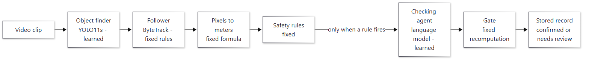
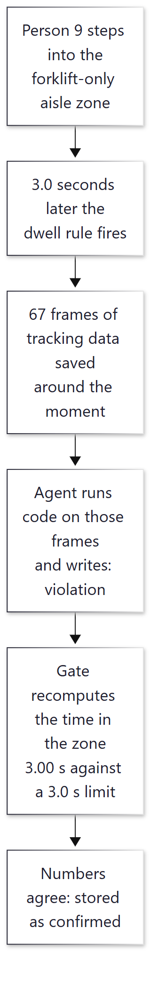
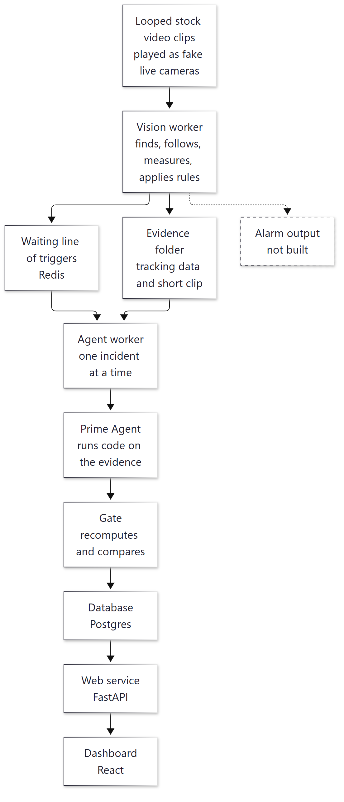
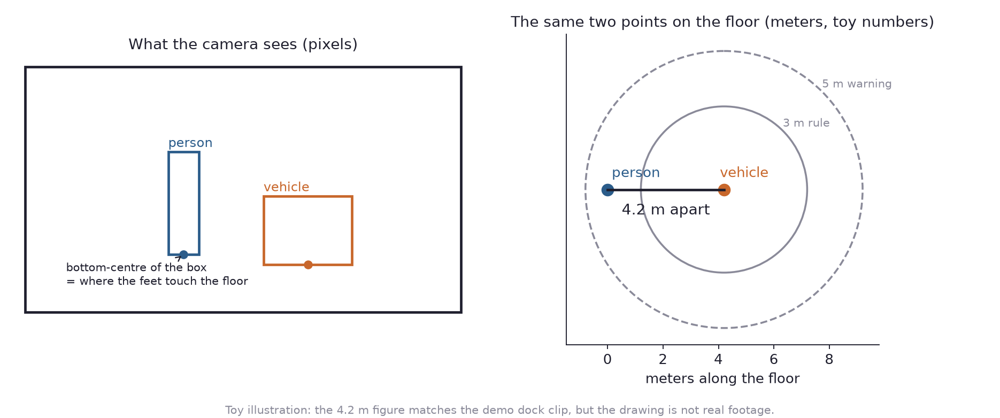
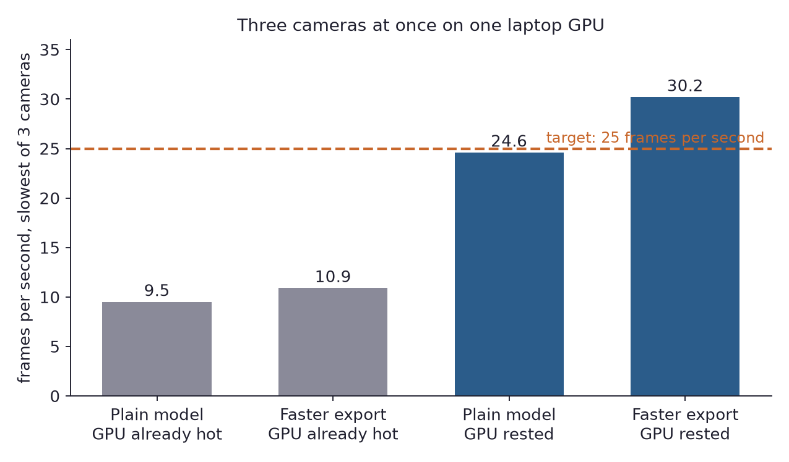
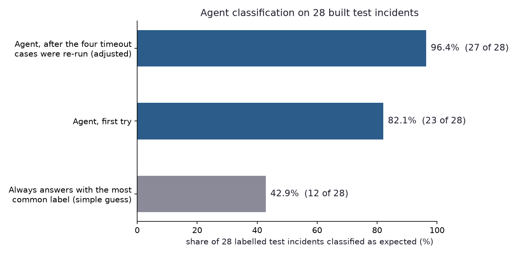
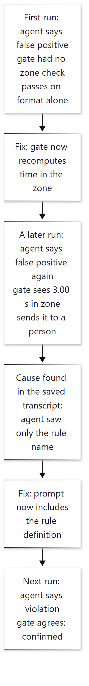

# SiteWatch AI (sitework-ai)

*A prototype that watches ordinary camera video for dangerous moments between people and vehicles, has an AI agent look at each alert, and has a plain-code checker recompute the agent's numbers.*

Status: a finished portfolio prototype, last code change on 27 September 2026. Code: https://github.com/PCSchmidt/sitework-ai (code under the MIT licence; the object-finding model and its library carry a stricter licence, described later). A recorded demo of the real dashboard is public at https://pcschmidt.github.io/sitework-ai/.

I built SiteWatch AI to show a way of combining two kinds of software that are usually kept apart. Warehouses and building sites mix heavy machinery with people on foot, and the worst accidents come down to a few situations: a forklift gets too close to a worker, someone stays too long inside a danger zone, or a vehicle goes too fast. SiteWatch AI takes video from an ordinary security camera, finds every person and vehicle in each frame, works out their real positions on the floor in meters, and checks written safety rules against those positions. When a rule fires, it hands a few seconds of evidence to an AI agent, which re-measures the event by writing and running code and then labels it. A separate piece of plain code, which I will call the gate, then recomputes the agent's key numbers from the same evidence and refuses to record a result that disagrees with them. Think of the gate as a referee: it does not play, it only checks the score.

There is no real site and no real camera: the "cameras" are three short stock video clips played on a loop. Everything else is real, working code, and I did not write it by hand. AI coding agents wrote almost all of it while I directed the scope, plan, architecture and preferences.

Here is what is fixed and what is learned. A calculator is deterministic: the same input always gives the same answer. A weather forecast is probabilistic: it is a best guess that can be wrong. SiteWatch AI is built on that split on purpose. The deterministic parts are the safety rules, the geometry that turns picture positions into floor positions, the gate and the database. They give the same output for the same input. The probabilistic parts are two learned programs. The first is the object finder, a model trained on a large collection of labelled pictures. What it sees depends on that training, and it can miss things in ways nobody wrote down. The second is the language model behind the agent, which writes its answer one word at a time with some chance built in, so the same incident has been answered two different ways on different runs. Chance and approximation also enter through a few assumed numbers in the camera set-up and a test set of only 30 incidents. To keep these in check, the learned parts never decide whether a rule fires, the agent must compute its numbers rather than guess them, the gate re-checks what it can, the agent has a hard time limit, and anything doubtful goes to a person.



The one idea that makes the project work is a split into two lanes with a referee between them. The fast lane does everything that has to happen on every frame, with no AI cost. The slow lane runs only when a rule fires. The gate sits between the slow lane and the stored record, and the agent cannot talk its way past the numbers the gate checks. The gate has limits, and the chapter on methods says exactly what it checks for each kind of alert. If you only have ten minutes, read the chapters on what it does, the models, the results, and the strengths and shortcomings.

Does it work? In a narrow frame, yes. The fixed rules ran on real stock footage and fired where they should. On 30 test incidents that I built by hand, the agent's answer passed the gate on the first try for 26 (87 percent), and all four failures were the same timeout, which the project then lengthened. On the labelling question, the agent agreed with the expected label on 23 of 28 labelled cases (82 percent), against 43 percent for a lazy guess of always giving the most common label. Two things hold those numbers back: the test incidents were hand-built, and no demo clip contains a genuine close call. Nothing here has been used for real work.

In short, SiteWatch AI is a working demonstration of an AI agent used as a checked part of a safety system, with encouraging results on its own test set and no use outside a laptop.

## What problem this solves

Picture a loading dock. A forklift backs out of a bay while a worker walks behind it, and they pass within a meter and a half. Nobody is hurt and nobody writes it down. A near-miss is exactly that: an event that came close to harm without causing it. Safety teams today lean on spot checks, signs and reviews after the fact. A system that watches continuously could record near-misses and show where the danger is.

The catch is that automatic alerts tend to fail in one of two ways. A system built only from fixed rules is fast, cheap and predictable, but it cannot tell a real near-miss from a glitch in the tracking or from harmless normal work, so it floods the operator with false alarms. A system that hands everything to a large language model (the kind of AI that powers chat assistants) can reason about context, but it is slow and costly to run on every frame, and it can state a distance with total confidence and be wrong. That is a poor fit when the question is "how close did the forklift actually get?"

My goal was a middle path. Keep the part that applies the safety rules fixed and easy to audit, meaning easy for someone else to trace and check. Use an AI agent only where judgment helps, which is deciding whether a flagged event was a real near-miss. Make the agent compute its answer rather than assert it, and put the gate behind it. The plan sets six success tests and lists what the project deliberately does not do: no live deployment, no real customer site, no control of real safety hardware such as an emergency stop, and no training of an object finder from scratch.

Commercial products already do camera-based safety monitoring, and they are far more capable than this. A skeptic would ask, "Why not just use one?" It would do the job better, but it would not show how to build the checking around the AI, which is the point here. The project also fits the central idea of my portfolio: systems should be checked before they are trusted.

In short, the project tackles the dilemma between false alarms and unreliable AI by splitting the work and checking the AI with plain code.

## Where the project came from

The idea began as a conversation with the Gemini AI assistant, which is saved in full in the repository. I had been using an open-source agent tool called Prime Agent and wanted to build something that used its ability to run a language model that writes and executes code. I then decided to build a separate app, outside my coursework repository for a Johns Hopkins University computer-vision course, as a portfolio piece showing a complex, deployable AI-enabled system. The project's documents record the same decision: a standalone application, with the coursework staying purely fixed-rule and this one a mixture of fixed and learned parts.

In short, SiteWatch AI began as a chat about agents and became its own portfolio application.

## What it does, step by step

SiteWatch AI does four things in order. It sees: an object finder locates every person and vehicle in each frame, and a tracker follows each one from frame to frame so that "person 42" stays person 42. Each followed object is called a track. It measures: a one-time camera set-up, called calibration, turns positions on the screen (pixels) into positions on the floor in meters. It decides: written rules check those floor positions every frame. It verifies: when a rule fires, the agent re-checks the event and the gate checks the agent.

Here is one incident from the project's own demo. The warehouse-aisle clip shows a pedestrian walking into a cross-aisle that is meant for forklifts only. The system tracks that person as track 9. The floor position puts them inside the forklift-only zone, and the zone rule says a pedestrian must not stay in it for 3 seconds. After 3.0 seconds the rule fires, and the system saves the surrounding tracking data (67 frames, about the few seconds around the event) and a short video clip. The agent opens the tracking data in a live programming session, writes code to measure how long track 9 was in the zone, and answers "violation". The gate then recomputes the time in the zone from the same data, gets 3.00 seconds against a limit of 3.0, agrees, and stores the incident as confirmed. The dashboard shows it.



The nearest everyday comparison is a camera operator, an auditor and an inspector. The operator watches every screen all day and shouts when a fixed rule is broken. The auditor is called only then, studies the recording and writes a report. The inspector re-measures the auditor's numbers with a tape measure before the report goes on file. The comparison breaks down in one way: this auditor is an AI, and it will sometimes answer the same question differently on a different day.

The intended user is a safety manager, who would see a live feed of incidents, a queue of "needs review" items to confirm or reject, and the evidence for each. Only I have used it, and the public demo replays recorded output. Everything is automatic except one thing: a person can record a review decision on a flagged incident through a form on the dashboard. That review is a record. It does not change the incident's state or stop anything. Use in a government or defense setting would need much that does not exist here: sign-in, protected data handling, approvals, and a way to run with no internet, which the hosted-model agent rules out today.

In short, video goes in, a checked and labelled incident record comes out, and every step but one human review form is automatic.

## The parts, the data and the rules

The system is a set of small programs that each do one job and pass work along a line. One program per camera finds and follows objects, applies the rules and saves the evidence. A second program takes each alert, starts the agent and applies the gate. A database stores the results, and a web dashboard shows them. The pieces run in Docker, a way of packaging a program with everything it needs. The names of the specific tools are in the code list at the end.



The dashed box is something the original design promised and I did not build: an alarm output. Rules fire within milliseconds, but nothing sounds a siren from them. A person sees an incident only after the agent step, which takes about a minute.

Everything that passes from one part to another is a small, strictly checked data packet: a snapshot of tracked objects in one frame, a record of which rule fired, or an incident record holding the verdict. The checker rejects extra fields, impossible values and unknown labels, and the agent sees only these packets, never raw video.

Three rules of behavior hold the design together. A record is either confirmed or marked "needs review", and nothing is silently dropped: if the agent times out, crashes or writes something malformed, the incident is stored for a person with the reason. A camera whose calibration is not accurate enough, with an average error above 2.0 pixels, loses its distance and speed rules instead of reporting numbers nobody can trust. And each rule has a cool-down, a pause before it can fire again for the same situation, so one event does not raise a stream of alerts. If the agent program crashes, the alert is not marked done and another worker picks it up after five minutes, and records are written so that processing an alert twice does no harm.

The data comes in three kinds. The demo clips are 12 to 25 second stock videos from Pexels, looped, and the project records each one's source and licence. For scoring the tracker, the project uses MOT17 (Multiple Object Tracking benchmark, 2017), a public set of crowd videos with people labelled frame by frame. The 30 test incidents are small hand-built scenarios, each holding an alert, the tracking data and the expected answer. The clips and the object finder's downloaded model file are kept out of the repository, so a fresh copy has to fetch them.

The weakest link is the agent's runtime. Prime Agent is not on the public package registry, so the agent container builds only from a copy saved locally, and a stranger cannot rebuild it. If the video grew tenfold, the first limit would be the graphics card, which meets the speed target only when cool.

In short, the parts are simple and separated by strict data packets, and the biggest practical weakness is that outsiders cannot rebuild the agent's runtime.

## The methods and the arithmetic

Most of the thinking sits in a few small methods, in the order a frame meets them.

**Following objects.** The tracker is ByteTrack, a published method for linking each new frame's boxes to the tracks already being followed. Imagine a teacher taking attendance by remembering where each child was a moment ago and expecting them nearby. As I understand the published method, it matches boxes by overlap and also uses low-confidence boxes to keep a track alive through brief blocks. It comes inside the library that supplies the object finder and is used as supplied.

**Turning pixels into meters.** This is the heart of the geometry. A camera sees a flat floor as a distorted picture, and a person's floor position is where their feet touch it, which the project takes as the bottom centre of their box. A homography (a mapping between one flat surface seen from two viewpoints) turns that pixel into a floor position. Toy example: suppose the four corners of a 100 by 100 pixel square are known to be the corners of a 2 by 2 meter square. The mapping then sends the pixel (50, 50) to the floor point (1, 1). The calibration's quality is how many pixels, on average, the known points land from where they should. In that toy case it is zero. Four points always fit exactly, so a quality check needs spare points: add a fifth at the centre, pick one corner wrongly by 3 pixels, and the average error becomes about 0.4 pixel, well inside the project's limit of 2.0. A failing score needs larger errors or more points. The project has three ways to build the mapping, depending on whether someone could measure real points on the floor. The two methods that work from lines in the picture need one assumed number, the height of the camera, and the dock demo estimates it from the spacing of a forklift's wheels and a worker's height. The project records that this makes every distance good to about 8 percent, one reason I treat its meters as estimates.



**Speed.** A speed measured over one frame is too jumpy. At 18 m away, one pixel of jitter in a box is about 7 cm, which over a tenth of a second reads as 0.7 m/s of fake speed. The project instead measures movement across about one second of history and reports a speed only once at least half a second exists.

**The three rules.** A proximity rule fires when a person and a vehicle stay within a set distance for a set time. A zone rule fires when a person stays inside an area drawn on the floor for a set time. A speed rule fires when a vehicle goes faster than a limit in a zone. The settings in the repository include a forklift within 3 m of a pedestrian for 2 seconds, a pedestrian in the forklift-only aisle for 3 seconds, and a vehicle over 2.2 m/s on the dock. In the project's tests, a person 4 m from a vehicle for 3 seconds and then 1 m away for 3 seconds fires a 5 m warning rule at 2 seconds and the 3 m rule at 5 seconds.

**The gate.** Its checks differ by kind of alert, and this is where the limits of the project's main promise sit. For a proximity alert, the gate rereads the saved tracking data, measures the distance between the two tracks in every frame and takes the smallest. Worked example from the project's own test incident: a person's distance from a forklift in four frames, one second apart, is 5.0, 3.0, 1.2 and 1.6 m. The smallest is 1.2 m, and the closing speed at that point is the drop from the frame before, 3.0 minus 1.2 divided by 1 second, or 1.8 m/s. The gate then compares what the fast lane and the agent claimed with those numbers, allowing 0.15 m or 5 percent of the claim, whichever is larger. For a zone alert, the gate recomputes the unbroken time the person has been in the zone at the moment of the trigger. In the project's tests, a person in the zone at 996, out at 997, and back in from 998 to 1000 has been in for 2 seconds at the trigger, not 4. A "violation" verdict needs that time to reach the limit, within 0.2 seconds, and a "false positive" verdict needs that it did not.

So the gate's promise is narrower than "the AI never has the last word". For proximity it checks numbers only: when the test incident above, with a true closest approach of 1.2 m, was fed to it with the labels "violation", "normal operations" and even "false positive", it accepted all three. For zone alerts it checks the time and the verdict together. For speed alerts it checks the format of the answer and nothing else. The project's README already admits the gate cannot catch a plausible wrong judgment between allowed labels, and this check shows the gap is wider than "plausible".

In short, the arithmetic is school-level geometry and averaging, small enough to check by hand, and the gate checks numbers for some alerts and format for others.

## The models and what they do

SiteWatch AI uses two learned models and no model it trained itself. The learned parts only suggest; whether a rule fires is decided by fixed code.

**The object finder: YOLO11s.** YOLO (You Only Look Once) is a family of object finders that look at a whole picture in a single pass, which makes them fast. YOLO11s is the small size of the eleventh version, supplied by Ultralytics. A frame goes in, resized to 640 pixels across. Out come boxes, each with a class name and a confidence between 0 and 1. The model learned from COCO (Common Objects in Context), a large public collection of everyday pictures labelled with 80 kinds of thing such as person, car, bus and truck. The project keeps boxes above a confidence of 0.4 and groups car, bicycle and motorbike into one class called vehicle. Its model file is downloaded at set-up.

Why this model? It and the smaller "nano" version both ran at about 35 frames per second on one 1080p stream, limited by video decoding rather than the model, so the more accurate one cost nothing. A transformer-based finder (RT-DETR, Real-Time Detection Transformer) was planned as a comparison and never benchmarked, and open-ended finders that take a typed name, such as Grounding DINO, were judged too slow.

Where does it fall short? COCO has no forklift or excavator class, which matters in a project about forklifts. The project tried three workarounds. Treating COCO "truck" and "bus" as a stand-in called "heavy vehicle" fired 325 times across the 304 frames of the real forklift clip (so it does fire on the forklift in real footage, though the count does not say how many hits were other trucks), but on synthetic warehouse images it found only 14.5 percent of forklifts. YOLO-World, a finder that works from a typed name, scored zero on the synthetic test. Training YOLO11s further on synthetic forklift pictures scored a weak 0.247 and found a forklift in none of the 304 real frames, the gap between simulated and real pictures. So the stand-in shipped because it was the only option that worked on the real clips, and the demo's alerts about "vehicles" should be read as alerts about something big and truck-shaped. The missing excavator class shows on the demo, where only the operator in the cab is boxed.

**The speed-up: TensorRT.** TensorRT is NVIDIA's tool for compiling a model to run faster on its graphics cards, and FP16 (16-bit floating point) is a half-precision number format that is faster and slightly less exact. On one stream, the compiled version was 34 to 57 percent faster. The project did not compare its detections with the plain version, and it is not the default in the running pipeline, so the speed-up is a measurement and not a promise.

**The agent: Prime Agent driving a language model.** Prime Agent is an open-source agent from Prime Intellect, built on the idea of a Recursive Language Model (RLM): a language model that works inside a live Python session, treating its inputs as data to compute on and calling further copies of itself like functions when a problem needs splitting. In plain terms, instead of reading numbers from a page and estimating, the agent loads the tracking file, writes code to measure the distance in every frame, and returns the result. The project runs it with no screen, one fresh process per incident.

The model behind it is whatever is set in Prime Agent's own configuration. The documents say a small, cheap model reached through OpenRouter (a service that sells access to many models) was used in the tests, at fractions of a cent per incident. The repository does not record the exact model name. What goes in is a prompt plus two files, the alert and the tracking data. What comes out must be a JSON file (JavaScript Object Notation, a plain structured text format) holding a measured distance, a closing speed, a time to collision, a label and the inputs it used. The label is one of four: normal operations, near-miss, violation or false positive. For a proximity alert the prompt gives numeric thresholds: below 2.0 m is a near-miss and below 1.0 m a violation. For zone and speed alerts it asks for a judgment: the claim holds up, does not, or is ambiguous.

Why this tool? The project's feasibility notes argue that the problem needs code-based verification, and a spike (a short time-boxed experiment) tested it for real. It produced correct, well-formed results in all five runs on a hand-computed incident, and in at least two of them noticed unprompted that the fast lane's claimed 1.7 m did not match its own 1.2 m. It did not solve everything. The tool's own turn limit did not stop a runaway task: a limit of 3 turns let it run 9 turns and over 130 seconds. So the real limit is a timeout enforced by the project's own code, which kills the process after 210 seconds. The alternative was a plain language-model call that returns JSON, which is simpler but gives the model nothing to compute with; a backup worker for that route exists only as a placeholder.

Where it falls short: the agent is nondeterministic, and on the first live run it got the aisle incident wrong, as the results chapter explains. It is also used narrowly. The designed compliance-auditor, shift-summary, scheduled and model-routing roles were not built. A written policy file for the agent exists, but nothing sends it, so the agent's rules live only in its prompts. For proximity alerts a simpler method could arguably do the job, since the gate already computes the same numbers; the agent adds value in the labelling, where judgment enters.

In short, a borrowed object finder and a borrowed agent do the learning, and fixed code decides when a rule fires and checks what it can of the agent's numbers.

## Testing and edge cases

An edge case is an unusual situation the program might not have been designed for. The project handles several of them. A calibration that fails its 2.0 pixel limit turns off distance and speed rules but leaves zone rules running, since they tolerate small position errors. Cool-downs are per rule, after a wide warning silenced a tighter rule. Speed rules skip pedestrians, after one fired on a walking worker. A missing evidence file becomes a "needs review" record, and a silent agent process is killed by the timeout.

Small bad inputs were also tried against the rules. A tracking file with no frames, or one missing one of the two tracks, is rejected by the gate with a clear reason. An agent answer with an extra field, a negative distance, the word NaN ("not a number") or an unknown label is rejected by the format check, and the word Infinity passes that check and is then caught as a mismatch by the gate. The same probing found four real holes, and the shortcomings chapter lists them once.

There are 191 automated Python tests. On a laptop 164 pass and 27 are skipped because they need a real database; in the project's automatic checks on GitHub those 27 run against a real database, and the latest run on the final commit succeeded. The code style checker and the strict type checker pass, as does the project's script that cross-checks its documents against the code. The tests use a stand-in agent that speaks the same protocol, so no real agent or model is called in them. Three tests spot-checked for this guide assert real behavior against hand-worked numbers: the zone case above, the 5 m and 3 m rules firing at 2.0 and 5.0 seconds, and a silent agent process killed in under 5 seconds.

What is not tested: a full run with a real agent in the automatic checks (the agent tool cannot be installed there), prompt-injection attacks (hostile text hidden in data to steer the agent), the dashboard beyond six tests, and anything with real cameras. As for planning, the first commit holds the plan with six success criteria, written before any results. It was a plan, not a locked protocol with a rule for what counts as success, and its final statuses were added afterward.

In short, the core logic is tested against hand-worked cases, and the main untested areas are the real agent in automation and hostile input.

## Does it work? The results

There are four sets of numbers, and none comes from a real site.

**Detection speed.** One object-finder stream at 1080p runs at 35.0 frames per second on the laptop's RTX A4500 GPU (Graphics Processing Unit, the chip that does heavy parallel computing and that the finder runs on). The video was converted from native 4K because decoding 4K, not the model, was the limit. The plan's target was three streams at 25 frames per second each. The result depends on how hot the card is. After more than an hour of heavy use, the slowest of three cameras ran at only 9.5 frames per second with the plain model, or 10.9 with the compiled one. After the card rested, it ran at 24.6 plain, just under the target, and 30.2 compiled, clearing it. The project publishes both. A system running all day would live nearer the hot figures, so the target is met only for bursts.



**Tracking accuracy.** On three MOT17 crowd videos of 200 frames each, the project scored MOTA (Multiple Object Tracking Accuracy) of 0.158, 0.259 and 0.459, and IDF1 (Identification F1, how well each person's identity is kept over time) of 0.32, 0.46 and 0.61. MOTA is 1 minus the share of mistakes (misses, false alarms, identity switches), so a tracker that finds nothing scores 0. The project's notes say competitive entries score 0.60 to 0.80 or more, and that this general finder faces scenes much denser than the demo's. So these scores are a floor for crowded scenes and not a claim about site footage.

**Agent checking.** The 30 built incidents were run one at a time through the real agent and the gate. Here "validated" means the agent's answer passed the format check and the gate as expected. Twenty-six of 30 did, which is 86.7 percent against a 90 percent target. All four failures were the same thing: the then 150-second timeout. Re-run with more time, all four finished correctly in 48 to 65 seconds, so the timeout was raised to 210 seconds, and the adjusted figure is 30 of 30. That adjustment was made after the fact on the same set, so I treat 86.7 percent as the honest first-try number.

For labelling, the agent matched the expected label on 23 of 28 labelled cases, or 82.1 percent, against 42.9 percent for always answering with the most common label (violation, 12 of 28). Four of the five misses were the timeouts, and with those four cases re-run the agent matched on 27 of 28, or 96.4 percent, which is the top bar in the chart. The fifth miss, the only real disagreement, was a speed alert of 2.3 to 2.4 m/s against a limit of 2.2 that the agent called a near-miss. That is a defensible judgment under the prompt, so it looks like a labelling mistake in the test set, and the project left it uncorrected rather than move the goalposts. The incidents were built by hand, and the repository does not say who wrote the labels.



**The demo incidents.** On the real clips, the full chain ran. On the dock clip the 5 m warning fired at 4.20 m, the agent recomputed 4.20 m and called it normal operations, and the gate confirmed. On the aisle clip the zone rule fired after 3.0 seconds and the agent returned violation, confirmed. Getting there is the most instructive part of the build.



On the first live run the agent called the intrusion a false positive although the person was in the zone for about 8 seconds, and the gate had no zone check. A zone check was added. On a later run the agent made the same mistake and the gate sent the incident to a person. The saved transcript showed why: the agent saw only the rule's name, "intrusion forklift aisle", and read it as a forklift intruding. The prompt now includes the rule's definition, and the next run was right. The caught run is kept in the demo, labelled as earlier.

**What did not work.** The object finder cannot see forklifts or excavators as such, one demo camera's calibration is deliberately unverified, the goal of fewer than five agent calls per ten minutes of video was never measured, and the three-camera speed target was met only on a rested card.

The numbers in this guide match the files the project cites. Nobody has repeated them from a clean copy, and the full pipeline needs a graphics card, manual downloads and a copy of Prime Agent that outsiders cannot obtain.

In short, the speed and agent results come from one laptop and hand-built incidents, and the clearest evidence of the design working is the one run where the gate caught the agent.

## Could it be put into real use?

No part of this has been operated for real users. The only reachable piece is the demo page, which replays recorded output including two real agent sessions; the repository shows no stars or forks. On a ladder from experiment, to works locally, to deployable, to operated, SiteWatch AI sits at works locally, with a good start on deployable: the full stack runs from one command with Docker, a replay stack with no graphics card and no AI runs from a fresh copy with only Docker, and the automatic checks run the tests.

Against usual production habits the picture is mixed. Automatic checks run the tests, the style and type checkers, the document check and validation of the cloud files, so a bad change is blocked, but no accuracy test can fail the build, because the agent is not available there. Failure handling is good for the agent step (timeout, safe re-runs, nothing silently dropped) and weaker elsewhere. Reviews are recorded but nothing depends on them, and the reviewer's name is typed in with no sign-in. There is no authentication, and network ports are bound to the local machine by default.

Some practices do mirror real work: a time-boxed spike before building the agent step, which found a limit that did not work; an external timeout added because of it; a test set whose timeout failures led to a measured change; a gate that caught a real agent error; recorded incidents that replay without paying for AI; and cloud configuration files for Amazon Web Services, Google Cloud and Microsoft Azure that pass validation and were deliberately never applied.

To deploy it for real users it would need hosting, sign-in, an alarm output, a rebuildable agent runtime, monitoring, video retention rules, a cost cap, a security review, an operating guide, a different detector licence and a safety case. Most are missing or only on paper. Three small steps would help most: run the real agent on a schedule once its package is obtainable, add a job that fails the build if agent accuracy drops, and write a short postmortem of the aisle incident. As a showcase it suits an engineering conversation about checking AI, but a safety system with an unauthenticated interface and a licence limit should not be put on the public internet.

In short, SiteWatch AI works on a laptop and as a recorded public demo, and is well past an idea but short of anything operated.

## Strengths, shortcomings and the work still to do

The project's strongest feature is how it treats the AI: the agent computes rather than guesses, a plain-code gate checks what it can, failure becomes a review rather than a lost event, and a real catch is kept in the demo. The repository's documents also separate what was built from what was not, and publish the hot-card speed numbers beside the best case.

The shortcomings fall into three kinds. Defects are things that are wrong. A damaged line in a tracking file makes the gate raise an error instead of rejecting politely, and from a reading of the code the alert would then be retried every five minutes without end, though I did not run that loop end to end. Speed alerts pass the gate on format alone. The calibration step accepts four points on a straight line, which cannot define a floor, and scores them at 1.15 pixels, inside the 2.0 limit. Confirmed incidents written by the real agent have an empty narrative field, although the documents describe each as carrying one. A tracker the project wrote is not used, and a per-track uncertainty value is always zero although the design said it would carry evidence quality.

Gaps are things missing: no alarm output, no live video overlay (the overlay replays recorded output), no helmet-and-vest detection, no authentication, no hostile-input testing and most of the planned agent roles. Deliberate limits are stated in the plan: no live deployment, no real equipment control, no real customer.

Three shortcomings matter most. First, nothing here shows accuracy on real incidents: the test incidents were built by hand, the clips contain no real close call, and the demo adds a 5 m warning ring so something fires. Second, the licence: the code is MIT, but the object finder and its library are under AGPL-3.0 (GNU Affero General Public License, a licence that requires sharing the source of software offered over a network), so any commercial or hosted use needs a commercial licence or a different finder. Third, the documents overstate in a few places. The GitHub description calls it a "multi-agent operations platform" for "chemical handling facilities" although one agent role runs and no helmet-and-vest detection exists, and the README says confirmed incidents carry a written narrative when the real agent's incidents have none.

The fixes are small: make a damaged file produce a review record, check that calibration points are not on a line, accept a proximity "false positive" or "normal operations" verdict only when the numbers support it, and correct the documents. The core is built and tested: detection, tracking, calibration, rules, evidence capture, the agent adapter, the gate, storage, the dashboard, replay mode and the cloud files. The extra agent roles, model routing, a real forklift class, an alarm output, authentication and live track streaming are not built.

Is it finished enough for its purpose? For a portfolio reference design, yes, and the project calls itself complete. The smallest work that would make it more convincing is a real close-call recording, the gate fixes, and an accuracy test on data not built by hand. I would polish and freeze it rather than extend it. Cost is near zero: the real agent costs about 0.2 cents per incident on the model the documents describe.

In short, the defects are small and fixable, the largest risks are the hand-built test data and the licence, and the best next step is repair and a real recording rather than new features.

## How it was built, and who did what

AI coding agents wrote almost all of the code, and I directed the scope, plan, architecture and preferences. I did not write the code by hand and I do not claim to have. The repository's README says the codebase was built with Claude Code, and 43 of its 55 commits carry a co-author credit for Claude: 37 for Claude Sonnet 5 and 6 for Claude Opus 5.5. The 12 uncredited commits are all from the first two days. The agent that runs inside the product, Prime Agent, is a component and not the builder. The original idea came out of a Gemini conversation, as described earlier.

The decisions I directed are recorded in the plan and the design records: the two-lane split, the rule that AI never sits in the path that decides whether a rule fires, local-first with nothing paid, cloud as checked files only, the cuts to scope, and the milestones with their acceptance tests. Short spikes came first, several fixes mention real bugs found by running the stack, and a late-September documentation pass compared claims with the code. The work landed between 15 and 27 September 2026 in 54 commits, plus one documentation commit on 19 October, 55 in all.

In short, I steered the design and scope, the agents wrote the code, and the history shows frequent self-correction.

## For recruiters and interviewers

**In thirty seconds.** I directed AI coding agents to build SiteWatch AI, a prototype that watches video for forklift and worker hazards with fixed rules, then uses an AI agent to examine each alert by computing, with a plain-code gate recomputing its key numbers. **In two minutes**, add that it uses an object finder and a language-model agent, has 191 tests, ran on real stock footage, and was measured on a 30-incident test set where the agent passed the gate 87 percent of the time on the first try and agreed with the expected label 82 percent of the time. Nobody but me has used it.

**What it demonstrates.** System design around AI, measurement and plain reporting, safety thinking (no AI in the path that fires a rule, a limit on the agent, a review queue), cost control, and directing AI agents with a written plan. It does not demonstrate operation for real users, on-call work, teamwork, scale, or building from scratch live.

| Typical requirement | What the project shows | Fit |
| --- | --- | --- |
| Agentic workflows with human oversight | One agent role, a gate, a review record | Partial: one agent, not a multi-agent system |
| Evaluating AI output | 30 built incidents, a simple-guess baseline, timeouts diagnosed | Partial: built data |
| Choosing models and trade-offs | Forklift workarounds, model-size benchmark, agent spike | Demonstrated, with failures recorded |
| Deploying and monitoring | Docker stacks, validated cloud files, recorded demo | Simulated: never operated |
| Governance and documentation | Design records, threat notes with status, licence notes | Demonstrated |

The strongest role family is the applied language-model and agentic-workflow engineer. The machine learning and MLOps fit (MLOps being the work of running models in production) is partial, since nothing was trained or monitored in production. The forward-deployed fit, meaning working with a customer on their own site, is weakest, since there was no customer.

**Likely questions.** What is it in a sentence? A prototype where fixed rules watch video and an AI agent examines each alert, with plain code recomputing the agent's key numbers. What was the hardest problem? Getting the agent right on the aisle incident, which took a gate change and a prompt fix. A decision that turned out wrong? Giving the agent only the rule's name; the saved transcript showed the misreading and the prompt now includes the rule's definition. How do you know it works? The tests pass and the agent was measured on 30 incidents, built and not real. What would you change? Record a real close call, fix the gate's gaps, and measure on data not built by hand. How would you put it in production? Not as it is: it needs sign-in, an alarm output, monitoring, a rebuildable agent runtime and a different detector licence, and I have not operated it.

**Tough questions.** *Isn't this a wrapper around someone else's models?* Partly: the object finder and the agent are borrowed. The geometry, rules, gate, evidence handling, tests and dashboard are the project's. *If agents wrote the code, what did you do?* I set scope, architecture and what counted as done, and I judged results. *Why should I believe the numbers?* They match the committed result files, with the caveats in the results chapter. *What if the input is malicious?* The format check helps, but there are no prompt-injection tests and no sign-in; I would not expose it.

**What not to exaggerate.** It is a prototype, not a product. There is no real site, the demo is recorded, the agent is one role, and I did not write the code by hand.

In short, the project shows how to build checking around an AI component, and it does not show production operation.

## Glossary

- **Agent:** an AI program that works toward a goal by taking steps, here by writing and running code.
- **Calibration:** the one-time set-up that turns picture positions into floor positions in meters.
- **Cool-down:** the pause before a rule can fire again for the same situation.
- **Gate (referee):** the plain-code check that recomputes the agent's numbers; the design calls it the band-3 gate.
- **Homography:** a mapping between a flat surface seen from two viewpoints.
- **Lanes (fast and slow):** the fast lane runs on every frame with no AI; the slow lane runs only when a rule fires.
- **Needs review:** the state of an incident the gate could not confirm; it waits for a person.
- **Track:** one object followed from frame to frame.
- **YOLO (You Only Look Once):** a family of fast object finders.

## Where to look in the code

This list is for engineers; other readers can stop here.

```
sitework-ai/
  pipelines/   vision (detector, pipeline, rules, evidence), geometry (calibration), broker (Redis), schemas
  agent/       worker, prime_adapter, band3 (the gate), prompts
  api/         FastAPI service and Postgres schema
  ui/          React dashboard and the recorded demo data
  config/      cameras, zones, rules, calibration files
  evaluation/  benchmarks, tracking eval, the 30 fixtures
  scripts/     replay demo, showcase agent, smoke test, docs check
  docker/      compose files and Dockerfiles (MediaMTX replays the clips as RTSP streams)
  deploy/      Terraform for AWS, GCP, Azure (validated, never applied)
  docs/        design suite, ADRs, spikes, results
  tests/       26 test files, 191 tests
```

Start-up points: `pipelines/vision/pipeline.py` for a camera, `agent/worker.py` for the agent step, `api/main.py` for the service. Run `make replay-up` for the Docker-only demo, or `uv sync` then `uv run pytest` (the sync pulls a multi-gigabyte graphics-card build of PyTorch). Without a database, 164 tests pass and 27 are skipped. Five files to read first: `agent/band3.py`, `pipelines/vision/rules.py`, `agent/prime_adapter.py`, `agent/worker.py`, `docs/12-roadmap.md`.
